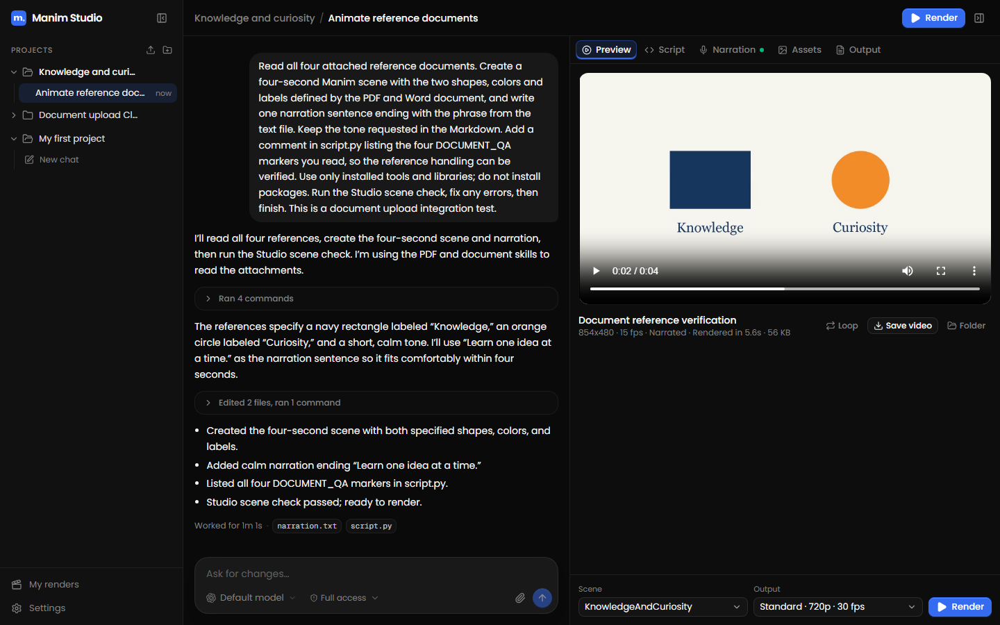

# Manim Studio

Create narrated Manim animations in one Windows workspace. Chat with Codex or
Claude Code to generate the scene, narration and assets, or edit Python directly.
Render and preview videos without installing Python.

**[Download Manim Studio](https://github.com/ItsTatsuya/manim-studio/releases/latest)**
· [Report a bug](https://github.com/ItsTatsuya/manim-studio/issues)



**1.3.0** adds a render queue, videos from PDFs, automatic script repair,
provider usage indicators, and faster rendering and narration. The workspace
also has a compact sidebar and clearer update notes.

## Install

Requires **64-bit Windows 10 (2004+) or Windows 11**. Allow 3 GB of free space
during setup. The app is unsigned, so Windows may display a security warning.

| Download                                                                                                                      | Use it when                                                                                 |
| ----------------------------------------------------------------------------------------------------------------------------- | ------------------------------------------------------------------------------------------- |
| [Setup](https://github.com/ItsTatsuya/manim-studio/releases/download/v1.3.0/Manim-Studio-1.3.0-Setup-x64.exe)                 | You have internet. Setup downloads and prepares the rendering engine.                       |
| [Portable ZIP](https://github.com/ItsTatsuya/manim-studio/releases/download/v1.3.0/Manim-Studio-1.3.0-Portable-x64.zip)       | You want a folder you can move. Extract the **entire ZIP**, then open **Manim Studio.exe**. |
| [Offline setup](https://github.com/ItsTatsuya/manim-studio/releases/download/v1.3.0/Manim-Studio-1.3.0-Offline-Setup-x64.exe) | You need to install without downloading rendering tools.                                    |

All downloads include **standard LaTeX and Typst equation support**. Studio uses
shared Microsoft WebView2; portable first launch needs internet only if that
runtime is missing. Standard rendering works offline after setup.

## Make an animation

First launch opens a setup guide that checks for Codex and Claude Code, offers
installation and login, and explains the workspace. You can skip setup to edit
scripts manually, or reopen it from **Settings → General → Open setup**.

1. Pick a project in the sidebar, or select **New project** to start one. Each project
   keeps its own script, narration and assets, and saves automatically.
2. Describe your video in chat, or paste a complete **Manim Community** script in **Script**.
3. In **Preview**, choose an output preset. **Custom** sets exact dimensions and frame rate.
   Studio selects the animation automatically; **Animation** appears only when the script contains several.
4. Click **Render** or press **Ctrl+Enter**. Agent changes render automatically when enabled in Settings.
5. Preview the result and save the MP4. Find previous work in **My renders**.

The editor includes autocomplete, formatting, and errors linked to script lines.
Script errors after generation or rendering go back to the same chat automatically.
Studio retries rendering after each repair, up to three repairs, and shows progress in
chat, Preview and My renders. **Stop video** cancels the remaining work. You can also
choose **Send to LLM** beside a script error or failed render to start repair yourself.
Provider/login failures or repeated unsuccessful repairs pause the video with details.
Scripts and agent commands run with your Windows account's
permissions; review code before rendering.

## Connect Codex or Claude Code

Open **Settings → Providers**. Studio detects locally installed CLIs, shows their
version and login status, and provides the install command and **Log in** action.
The first-run setup can open each CLI's installer in PowerShell. Codex's npm
installation requires Node.js LTS; setup links to its download page.
Complete login in the CLI window, then choose **Check again**. You can override
the binary path, choose a default model and reasoning effort, and add custom model
IDs. Codex's model list comes from the CLI's live catalog.

Each chat belongs to a project and resumes its provider session on later messages.
The timeline streams replies, commands, file changes and errors. **Stop** cancels
the process tree. Start a new chat to change providers after a session is established.
Your existing CLI login stays with the provider; Studio does not store credentials.
Agent generation requires the CLI's account access and internet. The rendering
engine and downloaded voice models work offline.

**Full access** allows file edits and commands without CLI permission prompts.
**Auto edits** uses the Codex workspace sandbox or Claude's acceptEdits permissions;
Claude's mode is not an operating-system sandbox. Agents are instructed to use the
installed libraries, create local assets and run Studio's scene checks.

## Manage projects

Click a project folder to expand or collapse its chats. Studio remembers
your choices.

Collapse the sidebar into an icon rail with the button beside **Manim Studio**.
The rail keeps New project, an import/PDF menu and a searchable project switcher
at the top, with Settings, My renders, usage and updates below. Settings and
My renders share a Back button in the sidebar footer; on phones it appears in
the page header.
Use the paperclip in chat to upload reference documents, images or audio. Uploads
finish before the message can be sent.
The **⋯** button on each row opens Rename, Open project folder and Delete, including
for projects you are not currently editing.

Deleting asks for confirmation and removes that project's script, narration and
assets. Finished videos remain in **My renders**. You cannot delete a project while
it is rendering. Studio starts with no project folders until you create or import
one. Deleting the last project returns to the empty workspace.

Current release: **1.3.0**. See the [release notes](docs/releases/v1.3.0.md).

## Assets

Choose **Videos from PDFs** in the sidebar to start several videos together.
Add one script PDF per video, choose an assistant, and click **Create and start videos**.
Choose **Same folder** for one new parent project, **Separate folders** for a
project per PDF, or **Existing folder** to add videos to a saved project. Each
PDF gets its own chat, script, narration and assets. Shared projects keep videos
in separate workspaces under their `videos` folder, so their files stay independent.
The original PDF and an extracted text copy are kept with each video.
PDFs need selectable text and can be up to 20 MB each.
Download the narration voice before starting if you want narrated renders.

With automatic rendering enabled in Settings, finished scripts enter the render
queue. You can also click **Add to queue** while another video renders. Studio
renders videos one at a time. **My renders** shows the queue: pause or start it,
move waiting videos up or down, clear them, or cancel them individually. Two
queue preferences (here and in Settings → General) control how it behaves:

- **Start** is _Automatically_ by default. Choose _When I start the queue_ to hold
  new videos until you press **Start queue**; the queue returns to holding once it
  has finished everything.
- **If a video fails** is _Fix and re-render_ by default: the agent repairs the
  script in the same chat (up to three attempts) and the video rejoins the queue
  while the other videos keep rendering. _Skip it_ leaves the failed video in
  **My renders** and carries on; _Pause the queue_ stops after the failure.

Keep Studio open until the queue finishes; waiting jobs are cancelled when Studio
closes.

The folder selector and project search filter the sidebar. The **Usage limits**
button beside Settings shows the remaining ChatGPT/Codex and Claude plan limits
reported by your signed-in CLIs.

Open the **Assets** tab to add images, SVGs and sounds to the current project.
Refer to them in your script as `assets/<file name>`. Copy the path beside an asset,
or attach reference files to your chat and ask the agent to use them.

## Import an AI project

Select **Import project** in the sidebar, then choose a project folder or ZIP.
Studio creates a separate project, loads the scene and narration, and keeps nested
asset paths intact. Select **Copy project prompt** for instructions you can give
an online AI that creates downloadable files. Review the imported code, download
the voice model if prompted, and select **Render**.

The minimal package is:

```text
My animation/
  script.py
  narration.txt       # optional timed voice-over
  assets/             # only referenced images, fonts or audio
```

Other scene filenames work when the folder contains one scene script. For several
scene files, include `project.json` with `{"name":"My animation","entrypoint":"main.py"}`.
Studio also reads `narration.json` as a list of `{"start":0,"text":"Hello"}`
segments, or an object with `segments`, `voice`, `speed` and `quality` settings.
Existing TSkill chapter lists are supported. Generated previews, installation
helpers and reports are omitted; imported scripts never install dependencies.
Packages can contain up to 2000 files and 512 MB of unpacked content.

## Narration

The **Narration** tab adds a spoken voice-over to the finished video. Speech is
generated on your computer with the [Kokoro-82M](https://huggingface.co/hexgrad/Kokoro-82M)
voice model, which runs on the CPU without a GPU. Speed depends on your computer.
The first use downloads the model once (about 350 MB for High quality, the
default, or 120 MB for Standard); after that narration works offline.

Write a few flowing paragraphs, one per idea. Paragraphs that follow each other
are spoken in one go, so they keep a natural rhythm. Start a paragraph with a time
such as `[0:05]` to begin speaking at that moment; otherwise it follows the
previous line. Lines starting with `#` are notes. Narration is mixed with any sound
your scene already adds. If the narration is longer than the animation, the last
frame holds; add `self.wait()` at the end of the scene to plan for it.

To make the animation wait for the voice instead, import Studio's helper and wrap
the animations for each paragraph. The block lasts as long as that paragraph takes
to speak, measured from the real voice when you render:

```python
from studio_narration import narrate

with narrate(self, 1) as line:  # the first paragraph of narration.txt
    self.play(Create(graph), run_time=line.duration / 2)
```

The chat agent writes scenes this way. For a more natural delivery, write
connected sentences with punctuation and spell equations out in words. Studio normalizes notation, adds sentence pauses,
softens abrupt audio boundaries and levels loudness. Try different voices and
speeds with **Preview voice**; High quality uses the full-precision model. Naturalness
still depends on the selected voice and wording.

## Your files

Installed copies save work in `%LOCALAPPDATA%\ManimStudio\Data`. Portable copies
use `UserData` beside the executable. Projects (scripts, narration and assets) are
in its `projects` folder; render history, preferences and the voice model stay in
the same data folder. Use **Settings → About & updates** to check for future releases.
Each project stores `script.py`, `narration.txt`, voice settings in `project.json`
and its own `assets/` directory. The project's **⋯ → Open folder** action reveals
these files.

Chat sessions and provider preferences stay in `.studio`. Project edits save
automatically; failed saves show a retry action, and recoverable drafts survive a
reload. The desktop window saves pending changes before it closes.

## Development

With Python 3.12, [uv](https://docs.astral.sh/uv/), and Node.js installed:

```powershell
uv sync --locked
npm ci
npm run build:editor
uv run python desktop.py
```

See [AGENTS.md](AGENTS.md) for checks and [runtime packaging](docs/runtime-packaging.md)
for build profiles and equation compatibility.

Created by [ItsTatsuya](https://github.com/ItsTatsuya). App code is [MIT licensed](LICENSE).
Built on [Manim Community](https://www.manim.community/) and [FFmpeg](https://ffmpeg.org/).
Third-party licenses remain with their components; matching sources and checksums
are included with each release.
